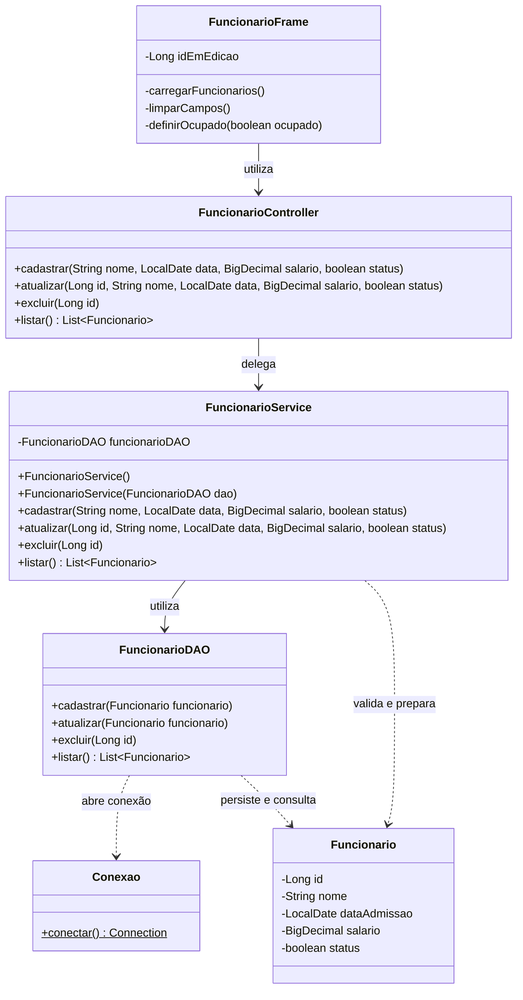

# Cadastro de Funcionários

Aplicação desktop desenvolvida em Java Swing para cadastro de usuários, autenticação e gerenciamento de funcionários, com persistência em PostgreSQL via JDBC.

As telas foram construídas com o editor gráfico do NetBeans, mantendo os arquivos `.form` para edição visual.

## Tecnologias

- Java 8
- Java Swing
- Apache NetBeans
- Maven
- PostgreSQL 14
- Driver JDBC PostgreSQL 42.7.4
- JUnit 4.13.2

## Funcionalidades

### Usuários e autenticação

- Cadastro com nome, e-mail, senha e confirmação de senha.
- Validação dos campos obrigatórios e do formato do e-mail.
- Verificação de e-mail já cadastrado.
- Senha com mínimo de 6 caracteres.
- Armazenamento do hash SHA-256 da senha.
- Login com as credenciais cadastradas.
- Opção de exibir ou ocultar senhas.

### Funcionários

- Cadastro com nome, data de admissão, salário e status.
- Listagem dos registros em uma JTable.
- Edição do funcionário selecionado.
- Exclusão com confirmação.
- Contador atualizado após cadastro e exclusão.
- Limpeza dos campos e cancelamento da edição.
- Retorno ao login pelo botão Sair.

### Validações e tratamento de erros

- Nome obrigatório, com até 150 caracteres.
- Data de admissão válida no formato `dd/MM/aaaa`.
- Salário não negativo, sem frações de centavo e dentro do limite do banco.
- Mensagens para falhas de conexão e operações SQL.
- Operações de banco executadas com SwingWorker para manter a interface responsiva.

## Arquitetura

O projeto utiliza uma organização em camadas, separando interface, regras de negócio e persistência.

| Pacote | Responsabilidade |
| --- | --- |
| `view` | Telas Swing e eventos da interface |
| `controller` | Comunicação entre telas e serviços |
| `service` | Validações e regras de negócio |
| `dao` | Operações SQL via JDBC |
| `model` | Entidades Usuario e Funcionario |
| `config` | Conexão com o PostgreSQL |
| `util` | Utilitários de geração de hash |

### UML — gerenciamento de funcionários

Diagrama simplificado das principais classes e dependências:



## Como executar

### 1. Clonar o repositório

```bash
git clone https://github.com/EduardoDserra/cadastro-funcionarios-java.git
cd cadastro-funcionarios-java
```

### 2. Preparar o banco

Crie um banco chamado `cadastro_funcionarios` no PostgreSQL.

No pgAdmin, abra o Query Tool conectado a esse banco e execute o script abaixo. As tabelas devem ser criadas uma única vez em um banco novo.

```sql
CREATE TABLE usuarios (
    id BIGSERIAL PRIMARY KEY,
    nome VARCHAR(150) NOT NULL CHECK (TRIM(nome) <> ''),
    email VARCHAR(254) NOT NULL UNIQUE,
    senha_hash VARCHAR(64) NOT NULL
);

CREATE TABLE funcionarios (
    id BIGSERIAL PRIMARY KEY,
    nome VARCHAR(150) NOT NULL CHECK (TRIM(nome) <> ''),
    data_admissao DATE NOT NULL,
    salario NUMERIC(12,2) NOT NULL CHECK (salario >= 0),
    status BOOLEAN NOT NULL DEFAULT TRUE
);
```

### 3. Configurar a conexão

Crie o arquivo `db.properties` na raiz do projeto, no mesmo diretório do `pom.xml`:

```properties
db.url=jdbc:postgresql://localhost:5432/cadastro_funcionarios
db.usuario=postgres
db.senha=SUA_SENHA
```

Ajuste host, porta, usuário e senha conforme seu ambiente.

Esse arquivo contém credenciais locais e não deve ser versionado. No Windows, confirme que ele não foi salvo como `db.properties.txt`.

### 4. Executar no NetBeans

1. Abra a pasta do projeto em **File → Open Project**.
2. Configure a plataforma Java do projeto para o **JDK 8**.
3. Execute **Clean and Build** para baixar as dependências, compilar e executar os testes.
4. Abra `br.com.carlos.funcionarios.Main` e selecione **Run File**.
5. Mantenha a raiz do projeto como diretório de trabalho, pois é nela que o arquivo `db.properties` será procurado.

Não existe usuário padrão. Na primeira execução, clique em **Criar conta**, cadastre seu acesso e faça login.

## Utilização

- Informe datas no formato `dd/MM/aaaa`.
- Informe o salário sem pontos de milhar ou símbolo de moeda, por exemplo: `2500,00`.
- Marque **Ativo** para cadastrar um funcionário ativo.
- Para editar, selecione uma linha e clique em **Editar selecionado**. Altere os campos e clique em **Salvar alterações**.
- Para cancelar a edição, clique em **Limpar**.
- Para excluir, selecione uma linha e confirme a operação em **Excluir selecionado**.

## Testes unitários

Os testes ficam em `src/test/java` e utilizam JUnit 4.

| Classe | Testes | Cenários |
| --- | --- | --- |
| `SenhaUtilTest` | 4 | SHA-256 conhecido, consistência, diferença entre maiúsculas/minúsculas e senha nula |
| `FuncionarioServiceTest` | 19 | Dados válidos, limites, entradas inválidas, atualização, exclusão, listagem e falhas simuladas do DAO |
| **Total** | **23** | |

Os testes de serviço utilizam um DAO simulado. Portanto, não dependem do PostgreSQL e não alteram os dados reais.

Execute pelo NetBeans com **Test** ou **Clean and Build**. Com Maven instalado e JDK 8 configurado, também é possível executar:

```bash
mvn clean test
```

Para compilar, testar e gerar o JAR:

```bash
mvn clean package
```

Resultado da última execução:

```text
Tests run: 23, Failures: 0, Errors: 0, Skipped: 0
BUILD SUCCESS
```

Os testes unitários cobrem a geração de hash e o serviço de funcionários. As consultas SQL e a interação com as telas não fazem parte dessa suíte.


## Autor

**Carlos Eduardo Desidério Serra**

- [GitHub](https://github.com/EduardoDserra)
- [LinkedIn](https://www.linkedin.com/in/carlos-eduardo-desiderio-serra/)
